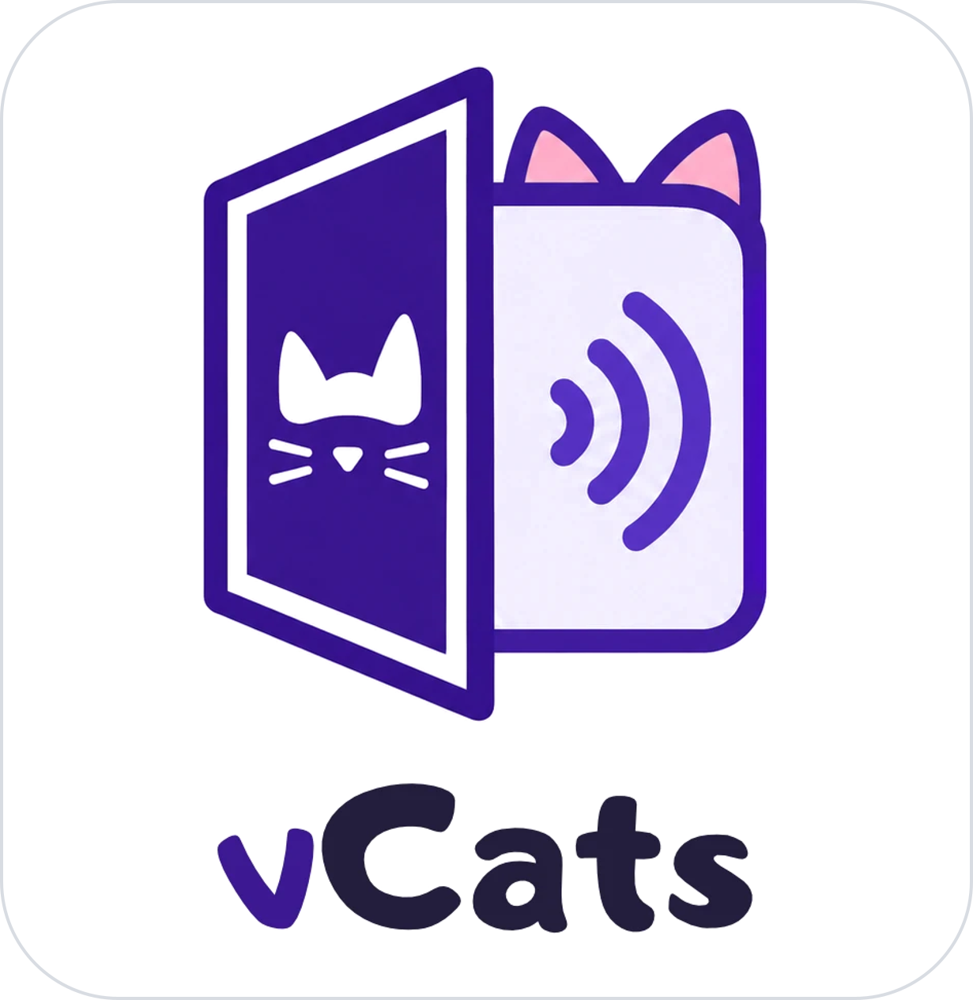

<p align="center">
  
</p>

<p align="center">
  <strong>Screen sharing for ViewBoard / vCast receivers</strong>
</p>

---

vCats is a command-line screen-sharing client written in Java for ViewBoard / vCast (EShare-compatible) receivers. It discovers receivers using a PIN or IP address, requests permission to share the screen and streams the desktop as H.264 video.

It can be used from the command line or through a graphical interface.

> **Experimental.** The protocol was reconstructed from the behaviour of the "vCastSender" Chrome extension (v3.2.1) and observations of a receiver on a local network. This project is not affiliated with or endorsed by any vendor.

## Table of Contents

- [Features](#features)
- [Requirements](#requirements)
- [Build](#build)
- [Testing](#testing)
- [Usage](#usage)
- [Graphical interface](#graphical-interface)
- [How it works](#how-it-works)
- [Project structure](#project-structure)
- [Platform notes](#platform-notes)
- [Troubleshooting](#troubleshooting)
- [Limitations](#limitations)
- [License](#license)

## Features

- Discovers receivers using a 6-character PIN or connects directly to an IPv4 address.
- Control channel with device identification, receiver properties and heartbeat.
- Two cast transports, selected automatically or forced from the command line:
  - **WebSocket**, as used by the Chrome extension.
  - **Plain TCP**, as exposed by the native PC receiver.
- Screen capture and H.264 encoding through the system `ffmpeg` on Windows, Linux and macOS. The screen is fitted to the chosen resolution without distortion, with black bars when the aspect ratio differs.
- Optional system audio sharing (`--audio`, experimental) on Windows, Linux and macOS. See [Audio](#audio).
- Supports both user-initiated sharing and receiver-initiated invitations.
- Test mode that sends a slowly panning photo of kittens instead of the desktop.
- Graphical control window built with Swing, featuring light and dark themes.
- Session lifecycle management, connection monitoring and structured logging.

## Requirements

- **JDK 22** or later.
- **Maven 3.9** or later (required to build the project).
- **ffmpeg** available on the system `PATH`, or specified using `--ffmpeg`.
- Sender and receiver connected to the **same local network**.

The program checks for ffmpeg at startup and, if it is missing, prints the installation command for the current system:

| System | Install command |
| --- | --- |
| Windows | `winget install Gyan.FFmpeg` |
| macOS | `brew install ffmpeg` |
| Linux | `sudo apt install ffmpeg` |

## Build

The project uses Maven to compile the Java sources and package them into an executable JAR.

From the project root, run:

```bash
mvn clean package
```

The resulting JAR is generated in the `target/` directory:

```text
target/vcats-1.0.0.jar
```

To launch the application:

```bash
java -jar target/vcats-1.0.0.jar
```

The JAR does not bundle ffmpeg: it must be installed separately and available on your system `PATH`.

The project can also be imported and built directly in IntelliJ IDEA. The entry point is `main.Main`.

## Testing

vCats includes automated unit tests written with **JUnit 5**.

The tests cover:

- Command-line options and default configuration.
- FFmpeg argument parsing.
- H.264 NAL unit parsing.
- H.264 access unit splitting, including chunk boundaries and size limits.
- PIN computation, address conversion and IPv4 validation.

Run the tests with:

```bash
mvn test
```

To run a specific test class:

```bash
mvn -Dtest=PinResolverTest test
```

To perform a clean build and run the complete verification lifecycle:

```bash
mvn clean verify
```

## Usage

Run the application with a receiver PIN or IP address:

```bash
java -jar target/vcats-1.0.0.jar <PIN|IP> [options]
```

Without arguments, the program opens the graphical interface.

Examples:

```bash
java -jar target/vcats-1.0.0.jar ABC123
java -jar target/vcats-1.0.0.jar 192.168.1.50 --size 1280x720 --fps 24
java -jar target/vcats-1.0.0.jar 192.168.1.50 --test
```

Press `Ctrl+C` to stop. The program attempts to terminate the sharing session, release the receiver and stop ffmpeg before exiting.

### Options

| Option | Default | Description |
| --- | --- | --- |
| `<PIN\|IP>` | Required | Receiver PIN (6 characters) or IPv4 address |
| `--name NAME` | Local host name | Device name shown on the receiver |
| `--type manual\|invited` | `manual` | `manual`: receiver must accept the share. `invited`: receiver requested it |
| `--size WxH` | `1920x1080` | Output resolution |
| `--fps N` | `30` | Frame rate |
| `--bitrate RATE` | `6M` | Video bitrate: `6M`, `4500k`, or a bare number in kbit/s. Between `100k` and `100M` |
| `--ffmpeg PATH` | `ffmpeg` | ffmpeg executable |
| `--input "ARGS"` | None | Custom ffmpeg input arguments, replacing the default screen capture |
| `--test` | Off | Send the kitten test image instead of the screen (and a test tone with `--audio`) |
| `--audio` | Off | Share the system audio (experimental) |
| `--audio-device NAME` | Automatic | Audio capture device; implies `--audio`. See [Audio](#audio) |
| `--raw` | Automatic | Force the plain TCP transport |
| `--ws` | Automatic | Force the WebSocket transport |

## Graphical interface

Start the program without arguments to open the control window:

```bash
java -jar target/vcats-1.0.0.jar
```

The window is organised into cards (Connection, Video and a collapsible Advanced settings section) and offers the same settings as the command line.

| Field | Option | Notes |
| --- | --- | --- |
| PIN or IP address | `<PIN\|IP>` | Required |
| Device name | `--name` | Defaults to the local host name |
| Share type | `--type` | Manual or invited |
| Transport | `--raw`, `--ws` | Automatic, native TCP or WebSocket |
| Resolution | `--size` | Presets or any `WIDTHxHEIGHT` |
| Frame rate | `--fps` | Presets or values from 1 to 60 |
| Bitrate | `--bitrate` | For example `6M` or `4500k`. A bare number means kbit/s |
| Share system audio | `--audio` | Experimental. See [Audio](#audio) |
| Test image | `--test` | Sends the kitten image instead of the screen |
| ffmpeg | `--ffmpeg` | Advanced settings. Path to the executable |
| Custom ffmpeg input | `--input` | Advanced settings. Leave empty to capture the screen |
| Audio device | `--audio-device` | Advanced settings. Leave empty to detect it automatically |

- **Start** validates the settings, locks the form and starts the session. Invalid values and connection errors are displayed above the log.
- **Stop** ends the share and releases the receiver.
- Closing the window during a share stops the session first.
- The **status indicator** shows the current stage: resolving, connecting, waiting, casting or stopped.
- The **log area** displays the same messages as the console.
- The **theme** follows the system setting at startup where supported. The button in the top right switches between light and dark.
- The **logo** is loaded from `assets/logo.png`. See [Assets](#assets).

## How it works

1. **Discovery.** A PIN encodes the receiver's address. The first octet is derived from the local network interfaces and each candidate is probed on the control port. An IP address is used directly.
2. **Control channel.** A WebSocket on port 57407 carries line-based text messages. The client introduces itself, requests receiver properties and sends a heartbeat every 3 seconds. The receiver reports events such as `startMirror`, `stopMirror` and `disconnect`.
3. **Transport selection.** The client checks the available cast transports and selects WebSocket or plain TCP. The transport can also be forced using `--raw` or `--ws`.
4. **Cast channel.** An RTSP-like exchange negotiates the session: `OPTIONS` for keep-alive, `SETUP` to start and `TEARDOWN` to end. The receiver's response is used to determine whether sharing is accepted.
5. **Video.** ffmpeg captures the screen and encodes H.264 with access unit delimiters. The client splits the stream into access units, sends the SPS/PPS configuration first and then the video frames, each preceded by a 128-byte header containing payload length, type and timestamp.
6. **Audio (optional).** A second capture process produces raw PCM (48 kHz, stereo, signed 16-bit). The client splits it into 20 ms packets and sends each one on the audio channel with the same 128-byte header, using the audio packet type.

### Ports

| Purpose | WebSocket transport | Plain TCP transport |
| --- | --- | --- |
| Control | 57407 | 57407 |
| RTSP | 51042 | 51040 |
| Video | 51032 | 51030 |
| Audio | 51033 | 51020 |

The control channel always uses WebSocket, regardless of the selected cast transport.

## Project structure

Java sources are under `src/main/java/io/github/vcats/`, automated tests under `src/test/java/`. Platform helpers (Swift, Python, C#) are under `src/main/native/`. Images are stored in `assets/`.

```text
assets/
├── logo.png
├── logo-readme.png
└── test-kittens.jpg

src/
├── main/
│   ├── java/io/github/vcats/
│   │   ├── Main.java
│   │   ├── config/        Options, Bitrate
│   │   ├── util/          Log, AppPaths, Processes, MacPermissions
│   │   ├── audio/         AudioCapture, AudioSource, AudioPump, LoopbackHelper
│   │   ├── ui/            ControlWindow, OptionsForm, LogPanel, theme/, widget/
│   │   ├── net/           Channel, WebSocketChannel, TcpChannel, Transport
│   │   ├── protocol/      Protocol, PinResolver, ControlClient, EShareClient
│   │   ├── media/         Ffmpeg, VideoPump, AuSplitter, H264
│   │   └── session/       CastRunner, CastSession, Phase
│   └── native/            Platform helpers that Java starts as separate processes
│       ├── macos/         SystemAudioCapture.swift
│       ├── linux/         vcats-portal.py   (Wayland screen capture)
│       └── windows/       vcats-loopback.cs (system audio)
└── test/
    └── java/io/github/vcats/
        ├── config/        OptionsTest
        ├── media/         AuSplitterTest, FfmpegTest, H264Test
        ├── net/           RtspFramerTest, WebSocketChannelTest
        └── protocol/      EShareClientTest, PinResolverTest
```

### Assets

The logo and the test image are looked up in this order: the working directory, the folder of the JAR (and up to five parent folders), and finally the `assets/` folder bundled inside the JAR. The Maven build packages `assets/` into the JAR, so a copied JAR works from any folder. If an asset is missing, the program still runs: without the logo in the window, and with a generated test pattern instead of the kitten image.

## Platform notes

### Video

| System | Capture backend | Notes |
| --- | --- | --- |
| Windows | `gdigrab` | Restart the IDE or terminal after installing ffmpeg so the new `PATH` is picked up |
| macOS | `avfoundation` | The terminal or IDE needs Screen Recording permission. vCats checks it, triggers the system prompt and opens the settings pane; after granting it, quit and reopen that app. The screen device index is detected automatically |
| Linux (X11) | `x11grab` | Works out of the box |
| Linux (Wayland) | desktop portal + PipeWire | The system "share your screen" dialog appears at each start. Needs `python3-gi`, `gir1.2-gstreamer-1.0`, `gstreamer1.0-pipewire` and `xdg-desktop-portal` with the backend for your desktop |

The captured screen is scaled to fit the chosen resolution without changing its aspect ratio, and padded with black bars when needed. Odd width or height values are rounded down to the next even number, as required by H.264.

### Audio

Audio is optional and experimental. It is enabled with `--audio` (or the "Share system audio" switch) and never stops the video: if no audio source can be started, the reason is logged and the share continues without sound.

| System | Source used | Requirements |
| --- | --- | --- |
| Windows | WASAPI loopback of the default output through a small helper (built automatically with the `csc.exe` that ships with Windows); falls back to an ffmpeg `dshow` loopback device | Nothing to install. Silence is sent while nothing is playing, so the stream keeps a steady clock |
| macOS | ScreenCaptureKit helper `native/macos/vcats-audio` if present, otherwise ffmpeg `avfoundation` on a loopback device | macOS 13 or later and Screen Recording permission for the helper, or a loopback device such as BlackHole |
| Linux | ffmpeg `pulse` on the monitor of the default output | PulseAudio or PipeWire with the PulseAudio compatibility layer |

Use `--audio-device NAME` to choose a device explicitly: a DirectShow device name on Windows, an AVFoundation audio device index or name on macOS, a PulseAudio source name on Linux (for example `alsa_output.pci-0000_00_1f.3.analog-stereo.monitor`). On Windows the device names are listed by `ffmpeg -list_devices true -f dshow -i dummy`, on macOS by `ffmpeg -f avfoundation -list_devices true -i ""`, on Linux by `pactl list short sources`.

With `--test --audio` a quiet 440 Hz tone is sent instead of the system audio, to check the audio path without any capture device.

To build the macOS helper:

```bash
mkdir -p native/macos
swiftc -O -parse-as-library src/main/native/macos/SystemAudioCapture.swift -o native/macos/vcats-audio
```

The helper is searched in the working directory and next to the JAR. It is not part of the Maven build and the compiled binary is ignored by git.

## Troubleshooting

**`Connection refused` when the cast starts**

The control port answered but the cast ports did not. The receiver may use the other transport: try `--raw` or `--ws`. If neither works, check that screen sharing is enabled on the receiver.

**`ffmpeg is not executable`**

Install ffmpeg or pass its location with `--ffmpeg`. On Windows, restart the IDE after installing so it sees the new `PATH`.

**The share is never accepted**

With `--type manual`, someone has to accept the request on the receiver. The program waits up to 60 seconds.

**Black or empty image on Linux**

The session is probably running under Wayland. Use `--input` with a Wayland-capable capture command, or log in to an X11 session.

**No sound on the receiver**

Check the log for a line starting with `audio disabled:`, which explains why no audio source could be started. Then try `--test --audio`: if the test tone is heard, the connection and the audio channel work and the problem is the capture device, which you can choose with `--audio-device`. If the tone is silent too, the receiver may expect a different audio format (see Limitations).

**The video looks blocky or blurry**

Raise the bitrate, for example `--bitrate 10M`, or lower the resolution or frame rate. The default of `6M` is meant for 1080p at 30 fps over a good Wi-Fi or wired connection.

**Checking the connection**

Run with `--test`. The receiver should show a slowly panning photo of kittens. This separates connection problems from screen-capture problems and shows whether the stream is live.

The image is read from `assets/test-kittens.jpg` (see [Assets](#assets)). If the file is missing, a generated test pattern is sent instead.

## Limitations

- Sender only: there is no receiver implementation.
- Audio is experimental. It is sent as raw PCM (48 kHz, stereo, 16-bit) in 20 ms packets, a format taken from the macOS helper and not yet confirmed against a real receiver. Audio and video are not explicitly synchronised.
- System audio capture needs a loopback source on Windows and macOS (Stereo Mix, a virtual cable or BlackHole); it is not available from the operating system alone.
- The control channel uses plain `ws://`, with no encryption or authentication beyond the receiver accepting the share. Use it only on trusted networks and with receivers you are authorised to use.
- Automated unit tests cover selected components; they do not replace integration testing with a real receiver.
- Hardware testing with a real ViewBoard is still pending.
- The macOS and Linux code paths, including audio capture, have not been tested on real hardware.
- The protocol is reconstructed, not officially documented. Other receiver versions may behave differently.

## License

Released under the MIT License. See [LICENSE](LICENSE) for the full text.
