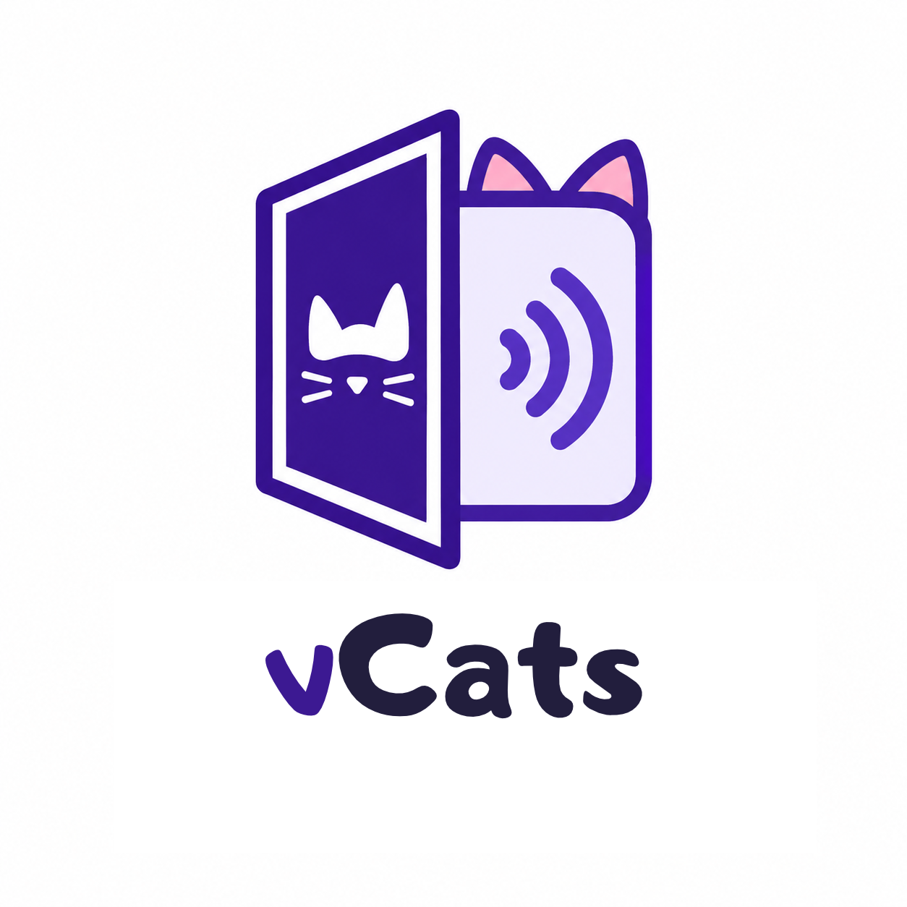

# VCats

<p align="center">
  
</p>

<h3 align="center">Open-source wireless casting software.</h3>

<p align="center">
  <strong>Cast your content, not your data.</strong>
</p>

<p align="center">
  An open-source approach to wireless screen sharing and media streaming.
</p>

---

## Overview

**VCats** is an open-source project focused on developing a wireless casting solution that enables users to share screens and stream multimedia content between compatible devices.

The project aims to provide a transparent, accessible and privacy-oriented alternative to proprietary casting ecosystems.

Traditional casting solutions often rely on closed protocols, vendor-specific applications, cloud services or platform-dependent implementations. VCats aims to explore a more open approach, giving users greater control over how their devices communicate and how their content is transmitted.

Our goal is straightforward:

**Wireless casting should be accessible, transparent and independent of unnecessary data collection.**

VCats is being developed with open-source principles at its core, prioritizing modularity, interoperability, security and ease of use.

> Your devices. Your network. Your content.

---

## Table of Contents

- [Overview](#overview)
- [Project Philosophy](#project-philosophy)
- [Core Objectives](#core-objectives)
- [Features](#features)
- [Architecture](#architecture)
- [Communication Model](#communication-model)
- [Security](#security)
- [Privacy](#privacy)
- [Technology Stack](#technology-stack)
- [Supported Platforms](#supported-platforms)
- [Getting Started](#getting-started)
- [Configuration](#configuration)
- [Development](#development)
- [Project Structure](#project-structure)
- [Roadmap](#roadmap)
- [Contributing](#contributing)
- [Reporting Issues](#reporting-issues)
- [FAQ](#faq)
- [License](#license)
- [Acknowledgements](#acknowledgements)

---

## Project Philosophy

VCats is built around a few fundamental principles.

### 1. Open Source First

The source code should remain publicly accessible and inspectable.

Users and developers should be able to understand how the software works, contribute improvements and independently review its implementation.

### 2. Privacy by Design

Casting content should not require unnecessary data collection.

VCats aims to minimize external dependencies and avoid unnecessary communication with third-party services.

### 3. Local Network First

Whenever technically possible, device discovery and communication should happen directly over the local network.

A cloud service should not be a mandatory component for basic local casting functionality.

### 4. User Control

Users should remain in control of their devices, connections and transmitted content.

Device discovery, connection authorization and session management should be transparent.

### 5. Simplicity

The complexity of the underlying technology should not become the user's problem.

The intended experience is simple: discover a compatible device, establish a connection and start casting.

---

## Core Objectives

| Objective        | Description                                                |
| ---------------- | ---------------------------------------------------------- |
| Wireless casting | Transmit screen content without physical video connections |
| Media streaming  | Support multimedia transmission between compatible devices |
| Device discovery | Identify available receivers on the local network          |
| Privacy          | Minimize unnecessary data collection                       |
| Security         | Protect communication and connection sessions              |
| Interoperability | Support multiple operating systems and devices             |
| Modularity       | Maintain independent and reusable software components      |
| Accessibility    | Provide a straightforward user experience                  |

---

## Features

The following list describes the project's development targets.

Implementation status will be updated as development progresses.

### Device Discovery

- [ ] Automatic discovery of compatible devices.
- [ ] Local network device enumeration.
- [ ] Receiver identification.
- [ ] Device availability monitoring.
- [ ] Manual connection by IP address or hostname.
- [ ] Device naming and identification.

### Wireless Screen Casting

- [ ] Desktop screen capture.
- [ ] Screen transmission over the local network.
- [ ] Configurable resolution.
- [ ] Configurable frame rate.
- [ ] Streaming quality configuration.
- [ ] Session management.
- [ ] Connection status monitoring.

### Multimedia Streaming

- [ ] Video streaming.
- [ ] Audio streaming.
- [ ] Audio/video synchronization.
- [ ] Media format compatibility.
- [ ] Streaming quality adaptation.

### Connection Management

- [ ] Receiver discovery.
- [ ] Connection establishment.
- [ ] Connection authorization.
- [ ] Session termination.
- [ ] Connection recovery.
- [ ] Multiple device handling.

### User Interface

- [ ] Device selection interface.
- [ ] Casting session controls.
- [ ] Connection status.
- [ ] Configuration panel.
- [ ] Error reporting.
- [ ] Cross-platform interface.

### Security and Privacy

- [ ] Secure communication channels.
- [ ] Receiver authentication.
- [ ] Connection authorization.
- [ ] Session isolation.
- [ ] Minimal data collection.
- [ ] Security documentation.

---

## Architecture

VCats is intended to follow a modular architecture.

Each component will have a clearly defined responsibility, allowing individual subsystems to evolve independently.

The proposed logical architecture consists of the following components.

### 1. Discovery Layer

Responsible for identifying compatible devices available on the network.

Responsibilities:

- Discover available receivers.
- Identify device capabilities.
- Maintain a list of available devices.
- Detect devices becoming unavailable.
- Provide discovery information to the connection manager.

### 2. Connection Layer

Responsible for establishing and maintaining communication between devices.

Responsibilities:

- Manage connection requests.
- Handle connection authorization.
- Establish communication sessions.
- Monitor connection state.
- Handle disconnections and reconnections.

### 3. Streaming Layer

Responsible for transmitting multimedia content.

Responsibilities:

- Capture screen content.
- Process audio and video streams.
- Handle encoding and decoding.
- Manage transmission.
- Synchronize audio and video.
- Handle streaming quality parameters.

### 4. Receiver Layer

Responsible for receiving and rendering transmitted content.

Responsibilities:

- Accept authorized connections.
- Receive incoming streams.
- Decode multimedia content.
- Render video and audio.
- Report receiver status.

### 5. User Interface Layer

Provides the interaction between users and the underlying system.

Responsibilities:

- Display available devices.
- Manage casting sessions.
- Expose configuration options.
- Display connection status.
- Report errors and warnings.

### 6. Security Layer

Provides security mechanisms across the communication architecture.

Responsibilities:

- Authenticate devices.
- Authorize connections.
- Protect communication channels.
- Validate incoming requests.
- Manage session security.

### Architecture Overview

```text
                 VCATS ECOSYSTEM

+--------------------------------------+
|              SENDER                  |
|                                      |
|  +-------------+  +---------------+  |
|  | Screen      |  | Audio Capture |  |
|  | Capture     |  |               |  |
|  +------+------+  +-------+-------+  |
|         |                 |          |
|         +--------+--------+          |
|                  |                   |
|          +-------v--------+          |
|          | Streaming      |          |
|          | Engine         |          |
|          +-------+--------+          |
|                  |                   |
|          +-------v--------+          |
|          | Connection     |          |
|          | Manager        |          |
|          +-------+--------+          |
+------------------|-------------------+
                   |
             Local Network
                   |
+------------------|-------------------+
|          +-------v--------+          |
|          | Receiver       |          |
|          | Connection     |          |
|          +-------+--------+          |
|                  |                   |
|          +-------v--------+          |
|          | Decoder        |          |
|          | Engine         |          |
|          +-------+--------+          |
|                  |                   |
|          +-------v--------+          |
|          | Audio / Video  |          |
|          | Rendering      |          |
|          +----------------+          |
|                                      |
|              RECEIVER                |
+--------------------------------------+
```

*This diagram represents the intended logical architecture, not a finalized implementation.*

---

## Communication Model

VCats aims to support direct communication between compatible devices.

The communication model is expected to involve the following stages:

1. **Discovery** – The sender identifies available receivers.
2. **Selection** – The user selects the destination device.
3. **Authorization** – The receiver validates the connection request.
4. **Establishment** – A communication session is created.
5. **Transmission** – Audio, video or screen content is transmitted.
6. **Termination** – The session is closed and associated resources are released.

### Network Considerations

The implementation will evaluate suitable technologies for:

- Local network discovery.
- Device identification.
- Connection establishment.
- Multimedia transport.
- Audio/video synchronization.
- Session management.

The final communication protocols and transport mechanisms are still subject to technical evaluation.

---

## Security

Security is a fundamental consideration in the design of VCats.

Wireless casting involves transmitting potentially sensitive information across a network. For this reason, the project aims to implement appropriate protection mechanisms.

### Security Objectives

- Prevent unauthorized receivers from accessing casting sessions.
- Ensure that connection requests are explicitly authorized.
- Protect transmitted content against unauthorized access.
- Validate incoming communication.
- Minimize unnecessary exposure of network services.
- Properly manage session termination.

### Security Principles

**Authentication**

Devices should be able to establish the identity of the communicating endpoint.

**Authorization**

A discovered device should not automatically receive permission to access a casting session.

**Confidentiality**

Communication channels should use appropriate encryption mechanisms.

**Integrity**

The implementation should protect transmitted data against unauthorized modification.

**Least Privilege**

Components should only receive the permissions required for their operation.

Security mechanisms and protocols will be documented as they are implemented.

---

## Privacy

Privacy is one of the main reasons behind the creation of VCats.

The project aims to avoid unnecessary dependencies on external platforms and services.

### Privacy Objectives

- Prefer local network communication.
- Minimize personal data collection.
- Avoid unnecessary telemetry.
- Avoid unnecessary cloud dependencies.
- Keep connection management transparent.
- Provide visibility into active casting sessions.

### Data Collection

VCats aims to avoid collecting personal information that is not necessary for its operation.

Any data processing required by the software should be documented and justified.

### A Simple Principle

Your screen is meant to be transmitted to your receiver.

Not to an advertising network, an analytics platform or an unnecessarily curious server.

---

## Technology Stack

The final technology stack is currently under evaluation.

The project will prioritize technologies that provide:

- Cross-platform compatibility.
- Efficient multimedia processing.
- Reliable network communication.
- Maintainability.
- Security.
- Open-source licensing.
- Active ecosystem support.

| Component              | Technology | Status           |
| ---------------------- | ---------- | ---------------- |
| Core engine            | TBD        | Under evaluation |
| Network discovery      | TBD        | Under evaluation |
| Communication protocol | TBD        | Under evaluation |
| Video encoding         | TBD        | Under evaluation |
| Audio processing       | TBD        | Under evaluation |
| User interface         | TBD        | Under evaluation |
| Build system           | TBD        | Under evaluation |
| Testing                | TBD        | Under evaluation |

Technology choices will be documented as the architecture becomes more concrete.

---

## Supported Platforms

Cross-platform compatibility is a development objective.

| Platform  | Status           |
| --------- | ---------------- |
| Windows   | Planned          |
| Linux     | Planned          |
| macOS     | Planned          |
| Android   | Under evaluation |
| iOS       | Under evaluation |
| Smart TVs | Under evaluation |

Platform support depends on operating system APIs, multimedia capabilities and available hardware.

No platform should be considered officially supported until it has been tested.

---

## Getting Started

VCats is currently under development.

Installation instructions and executable releases will be provided when the first usable version becomes available.

### Prerequisites

Requirements will depend on the selected technology stack and target platform.

### Installation

Installation procedures are not yet finalized.

### Running VCats

Execution instructions will be added once the initial application architecture and build process are established.

---

## Configuration

The configuration system is expected to provide control over the main casting parameters.

Potential configuration options include:

| Parameter         | Description                       |
| ----------------- | --------------------------------- |
| Device name       | Local device identification       |
| Discovery         | Device discovery settings         |
| Network interface | Preferred network interface       |
| Resolution        | Output resolution                 |
| Frame rate        | Streaming frame rate              |
| Audio             | Audio transmission settings       |
| Security          | Connection authorization settings |

Configuration options will be documented as they become available.

---

## Development

VCats welcomes developers interested in networking, multimedia processing, application development and cybersecurity.

Development will focus on creating a maintainable and modular codebase.

### Development Priorities

1. Define the system architecture.
2. Evaluate network communication technologies.
3. Implement device discovery.
4. Establish sender/receiver communication.
5. Develop the streaming engine.
6. Implement connection security.
7. Build the user interface.
8. Perform compatibility and performance testing.

### Code Quality

The project aims to maintain:

- Readable and maintainable code.
- Consistent coding conventions.
- Modular components.
- Meaningful commit messages.
- Documented interfaces.
- Reproducible builds.
- Automated testing where applicable.

---

## Project Structure

The repository structure will evolve with the implementation.

The proposed organization is:

```text
VCats/
│
├── assets/
│   └── logo.png
│
├── docs/
│   ├── architecture.md
│   ├── protocols.md
│   ├── security.md
│   └── development.md
│
├── src/
│   ├── core/
│   ├── discovery/
│   ├── connection/
│   ├── streaming/
│   ├── receiver/
│   ├── security/
│   └── interface/
│
├── tests/
│
├── examples/
│
├── .gitignore
├── LICENSE
└── README.md
```

*This is a proposed structure. Directories will be created when the corresponding components are implemented.*

---

## Roadmap

VCats follows an incremental development approach.

The roadmap is divided into development milestones.

### Phase 1 — Foundation

- [ ] Define project architecture.
- [ ] Select the technology stack.
- [ ] Define communication requirements.
- [ ] Establish repository conventions.
- [ ] Prepare development documentation.

### Phase 2 — Network Communication

- [ ] Implement device discovery.
- [ ] Implement device identification.
- [ ] Establish sender/receiver communication.
- [ ] Implement connection management.
- [ ] Test local network communication.

### Phase 3 — Streaming Engine

- [ ] Implement screen capture.
- [ ] Implement video encoding.
- [ ] Implement video transmission.
- [ ] Implement receiver decoding.
- [ ] Evaluate audio transmission.
- [ ] Optimize latency and performance.

### Phase 4 — Security and Privacy

- [ ] Implement receiver authentication.
- [ ] Implement connection authorization.
- [ ] Protect communication channels.
- [ ] Review data collection.
- [ ] Perform security testing.

### Phase 5 — User Experience

- [ ] Develop the graphical interface.
- [ ] Implement device selection.
- [ ] Implement session controls.
- [ ] Add configuration options.
- [ ] Improve error handling.

### Phase 6 — Release

- [ ] Complete integration testing.
- [ ] Perform cross-platform testing.
- [ ] Prepare installation documentation.
- [ ] Publish the first public release.
- [ ] Establish a stable release process.

---

## Contributing

Contributions are welcome.

Whether you are interested in networking, multimedia, security, interface development or documentation, there are several ways to participate.

### How to Contribute

1. Fork the repository.
2. Create a dedicated branch.
3. Implement your changes.
4. Test your implementation.
5. Commit your changes.
6. Open a Pull Request.

### Contribution Guidelines

Please ensure that contributions:

- Follow the existing project structure.
- Include appropriate documentation.
- Do not introduce unnecessary dependencies.
- Respect privacy and security principles.
- Include tests where applicable.
- Clearly describe their purpose.

### Issues and Feature Requests

Before opening a new issue, check whether a similar report already exists.

When reporting a bug, include:

- Operating system and version.
- Relevant hardware information.
- Steps to reproduce the issue.
- Expected behavior.
- Actual behavior.
- Relevant logs or error messages.

---

## FAQ

### What is VCats?

VCats is an open-source project focused on wireless casting and multimedia transmission between compatible devices.

### Is VCats open source?

Yes. The project is being developed as open-source software. The exact license will be specified before the first public release.

### Does VCats require an internet connection?

The project aims to support local network communication without requiring cloud connectivity for basic casting functionality.

The exact requirements will depend on the final implementation.

### Does VCats collect user data?

Privacy is a core design objective. The project aims to minimize data collection and avoid unnecessary telemetry.

Actual data handling will be documented as the software is implemented.

### Is VCats compatible with every device?

Not currently. Cross-platform compatibility is a development objective, and support will depend on the available operating system and hardware capabilities.

### Is VCats an alternative to proprietary casting solutions?

That is the long-term objective: to provide an open, transparent and privacy-oriented alternative.

---

## License

The project license is currently **TBD**.

A license will be selected and added before the first public release.

Until then, no assumptions should be made about redistribution, modification or commercial use of the source code.

---

## Acknowledgements

VCats is built on the work of the open-source community.

We recognize the developers and maintainers of the libraries, tools and technologies that make open-source software possible.

---

## VCats

**Open-source wireless casting software**

*Cast your content, not your data.*

Made with curiosity and a healthy distrust of unnecessary telemetry. 🐱
